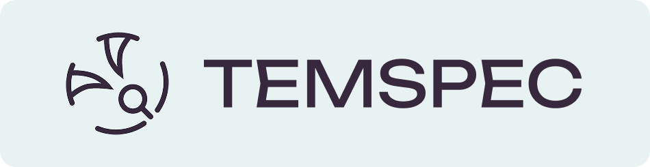
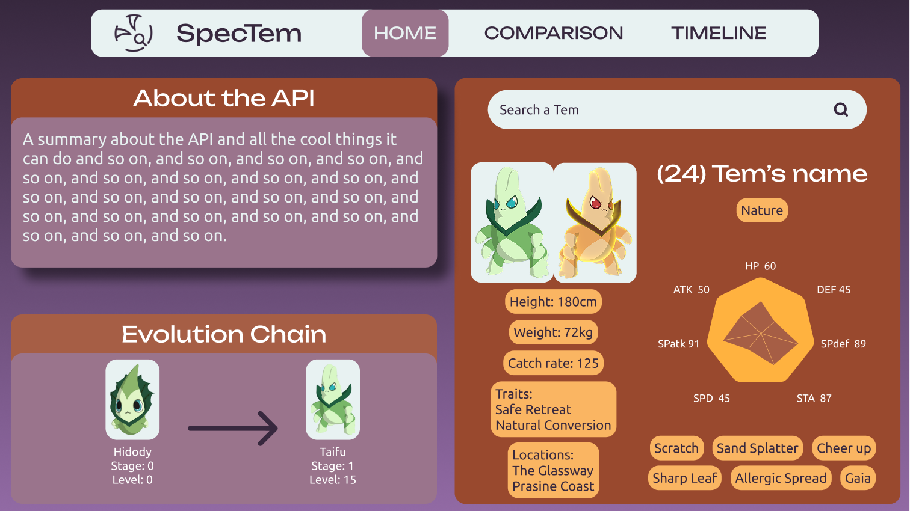
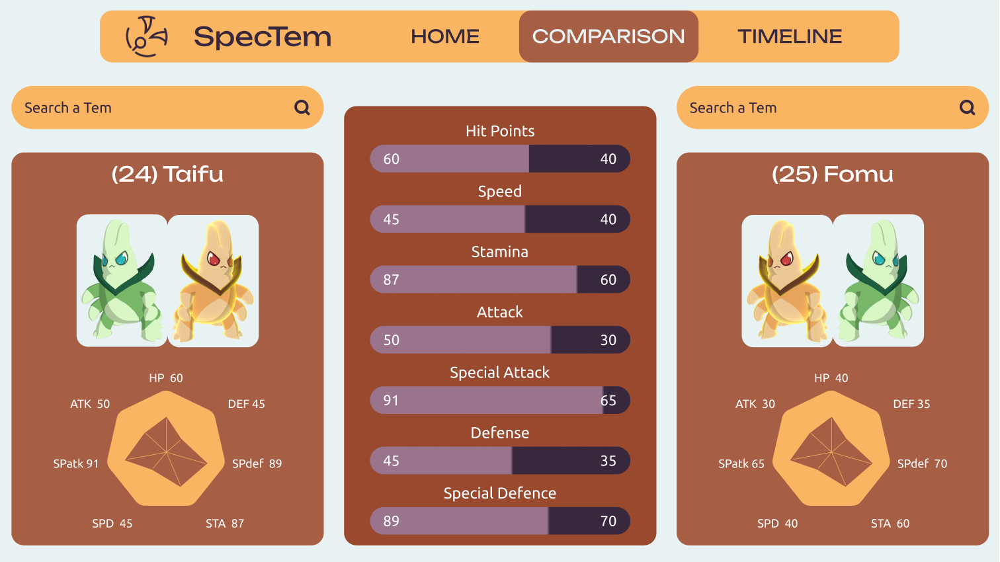
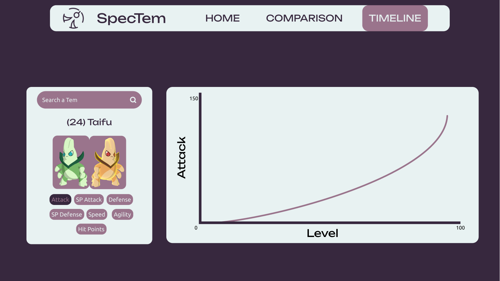
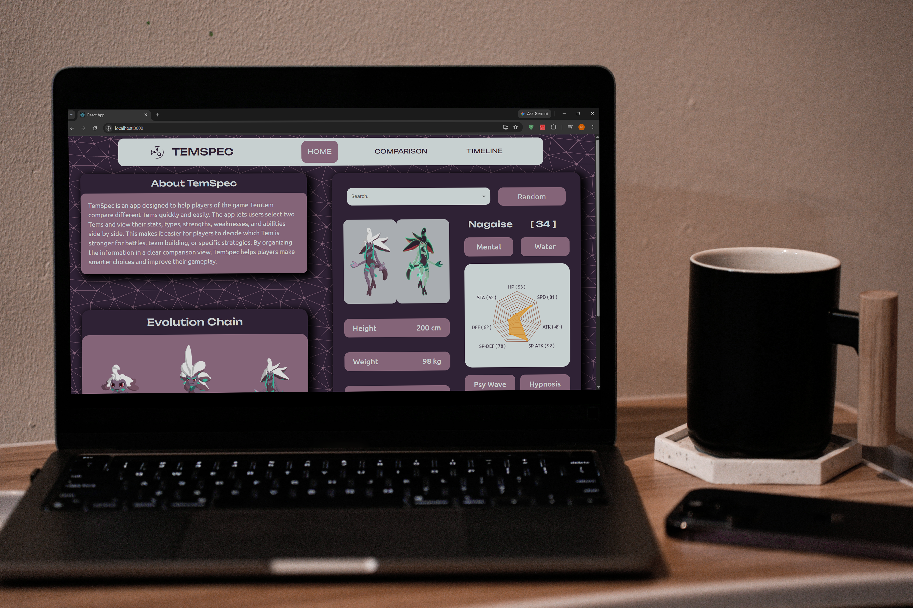
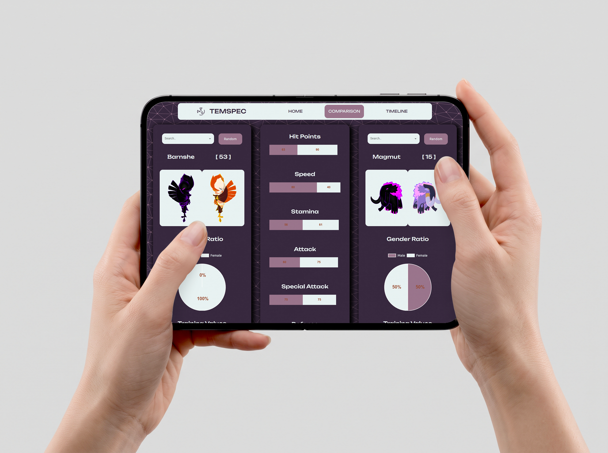

<div align="center">
  
</div>

# About

Temspec is an application that allows users to view the statistics of specific Tems and compare them to each other.
Tems are creatures from a popular video game franchise called TemTem, a creature-collection adventure.

## Built With

[](https://react.dev/)
[](https://www.javascript.com/)
[](https://www.w3schools.com/html/)
[](https://www.w3schools.com/css/)
[](https://react-bootstrap.netlify.app/)
[](https://mui.com/)
[](https://react-chartjs-2.js.org/)

# Features

- Search for or randomly select Tems and view their information.
- View graphs of selected Tem stats.
- Search and compare two Tems, or compare randomly.
- Chart showcasing a Tem’s growth as they level.

# Development

Additional documentation can be found under the design folder:

```
temspec/assets/API Research & Planning.pdf
```

## Wireframes

<table border="0">
<tr>
    <td><h1 align="center">Landing Page</h1></td>
  </tr>
  <tr>
    <td></td>
  </tr>

  <tr>
    <td><h1 align="center">Comparison Page</h1></td>
  </tr>
  <tr>
    <td></td>
  </tr>

  <tr>
    <td><h1 align="center">Timeline Page</h1></td>
  </tr>
  <tr>
    <td></td>
  </tr>
</table>

# Development Process & Challenges

This project was created using a React framework, which was the first time I would use it. 

### Creating Components
Throughout the project, I constantly had to ask myself whether I was using a certain part of the application over and over; if so, I made it a component. Making this mental shift helped me form the habit of thinking about how I can make components and have them be slightly customisable to suit my needs for specific sections of the application. This project taught me the basis of component based development.

### Communication Between Components
Due to React and the concepts of useStates and useEffects being new to me, I struggled a bit with following the logic of how to carry information between components. However, after realising that it’s very similar to passing arguments to other functions and understanding that useStates are variables that update the components, it went a lot smoother.

### ChartJS Graphs
ChartJS, on the other hand, was not as intuitive. I had to scour the documentation and do a few Google searches to understand how the charts worked to an extent. I also needed to learn how the charts take information and how I can edit the selected part, like labels, for example.

## Mockups

<div align="center">
  
  
</div>

# Installation

## Local Setup
### Prerequisites

- [Node.js](https://nodejs.org/) and npm
- A code editor (VS Code, Notepad++, etBrains IDEs etc.)
- Git

### How to Install

1. **Clone the Repository**

```bash
git clone https://github.com/Nell-JvR-251061/temspec
cd temspec
```

2. **Set Up the Application**

Open a new terminal:

```bash
npm install
npm run start
```

3. **Run the Project**

Visit the app at the local URL printed (typically `http://localhost:3000`).

---

## Demonstration
[Temspec Demo](https://drive.google.com/file/d/1gX14s8G-hpl2ZqvOLIQPcBQj_hhJrvuk/view?usp=sharing)
